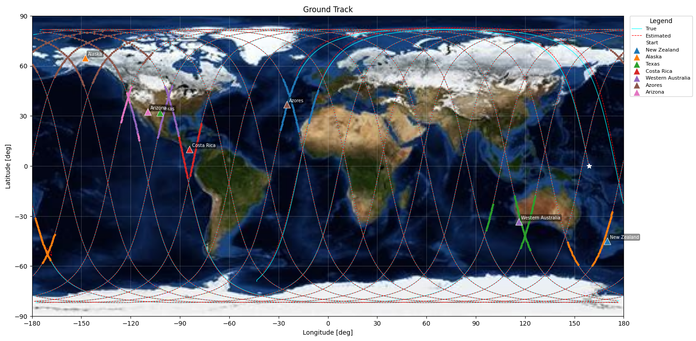
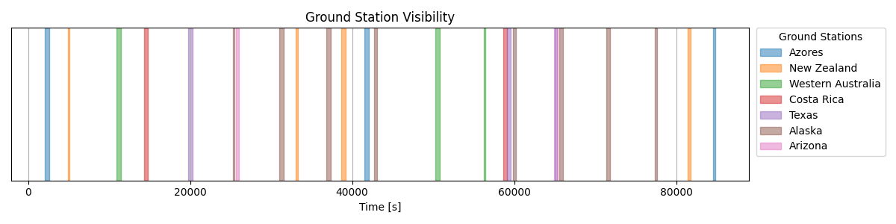
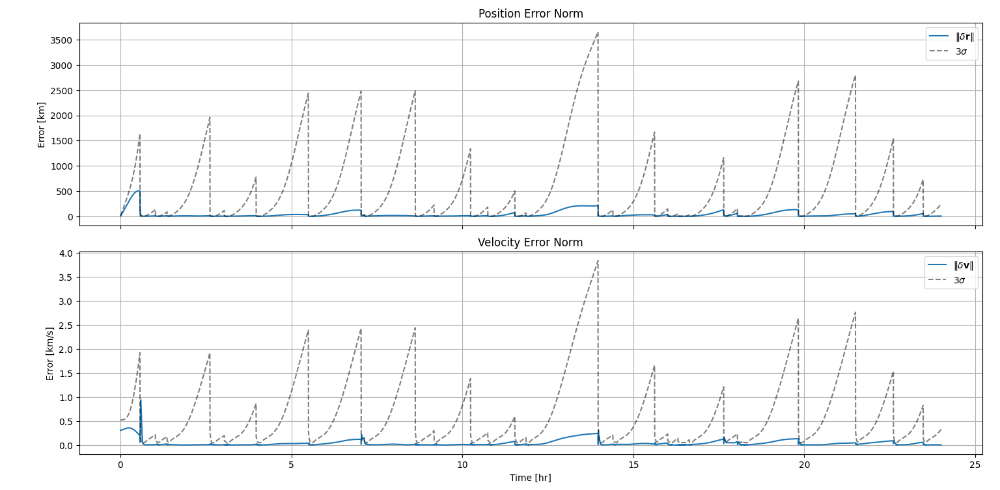
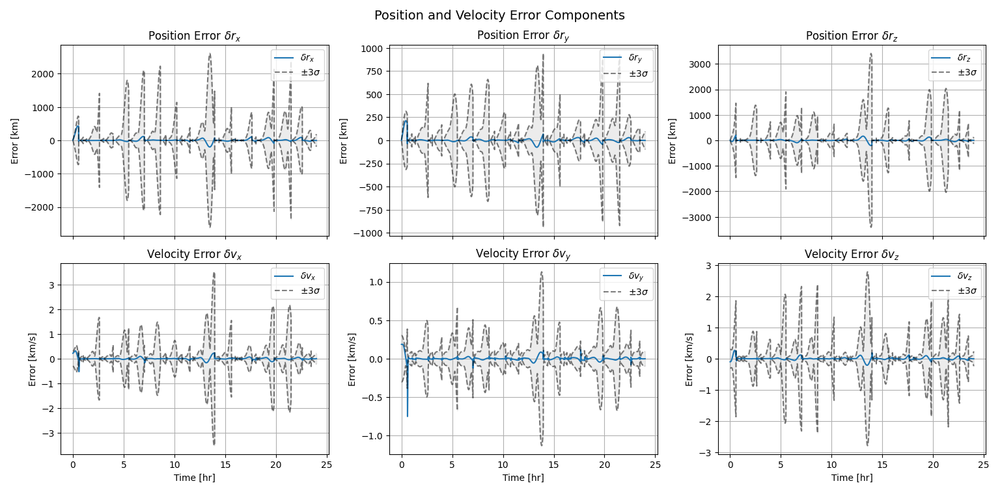
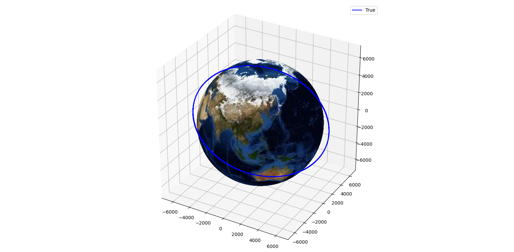

# Ground Station Tracking — EKF Orbit Determination

Estimates a spacecraft's orbit in LEO using an Extended Kalman Filter (EKF)
with measurements from the LeoLabs ground station network.

## Overview

- **Dynamics:** Two-body orbital mechanics propagated with `solve_ivp`
- **Filter:** Extended Kalman Filter (EKF) with Joseph-stabilized covariance update
- **Measurements:** Range, range-rate, elevation, and azimuth from ground stations
- **Ground Network:** 8 LeoLabs radar sites worldwide

## Results

### Ground Track


### Ground Station Visibility


### Position & Velocity Error (Norm)


### Position & Velocity Error (Components)


### 3D Trajectory


## Setup

```bash
pip install numpy scipy matplotlib pillow
python ground_station_tracking_sim.py
```

## File Structure

```
├── ground_station_tracking_sim.py
├── config.py
├── plots/
│   ├── groundtrack.png
│   ├── visibility.png
│   ├── error_norm.png
│   ├── error_components.png
│   └── trajectory_3d.png
├── utils/
│   ├── dynamics.py
│   ├── frame_conversion.py
│   ├── measurement.py
│   └── measurement_jacobian.py
└── earth.jpg
```
